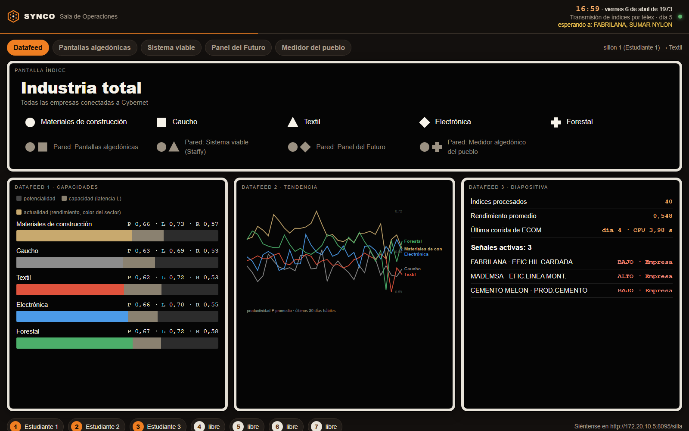
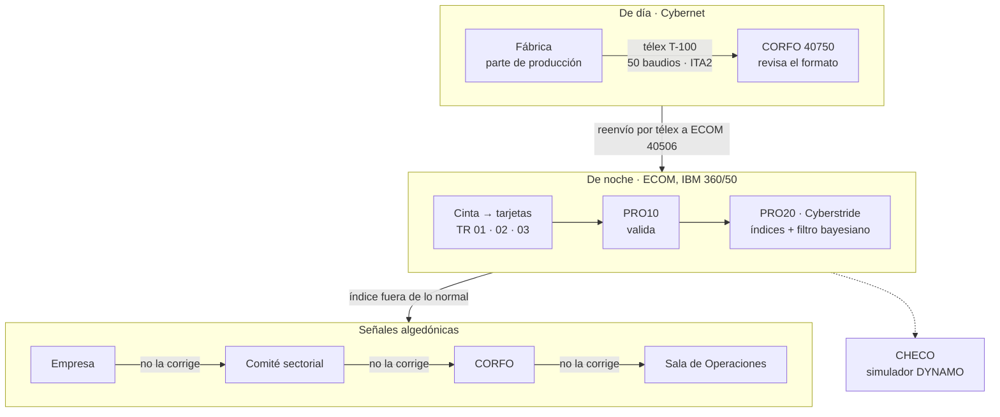
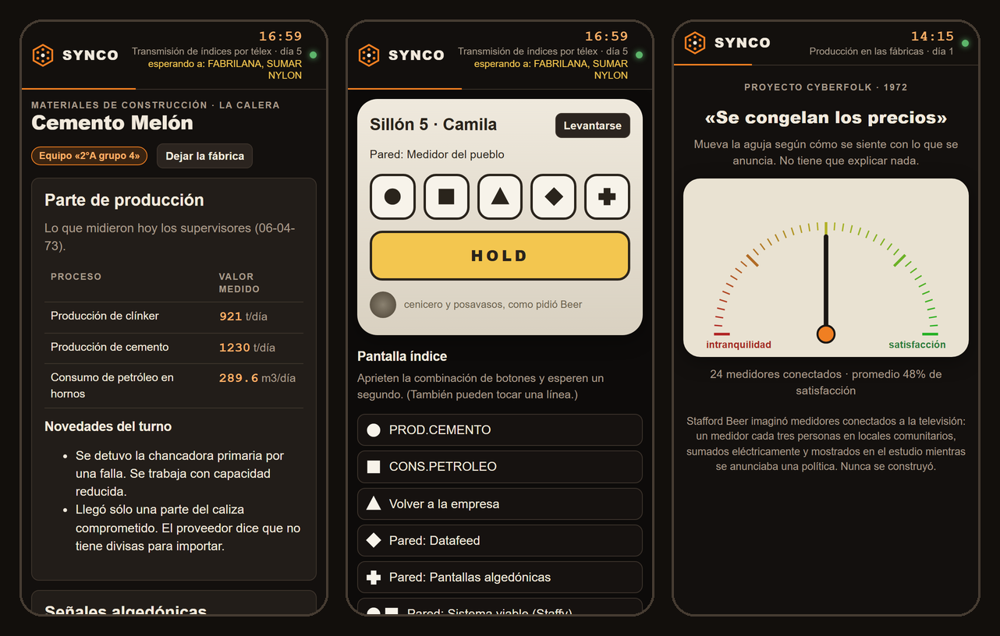
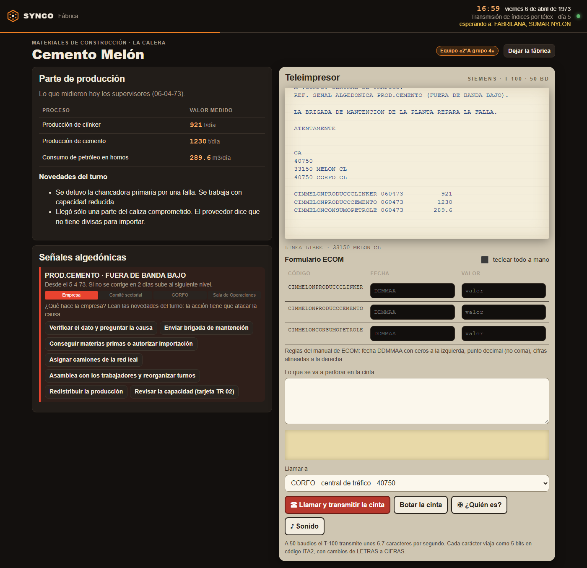
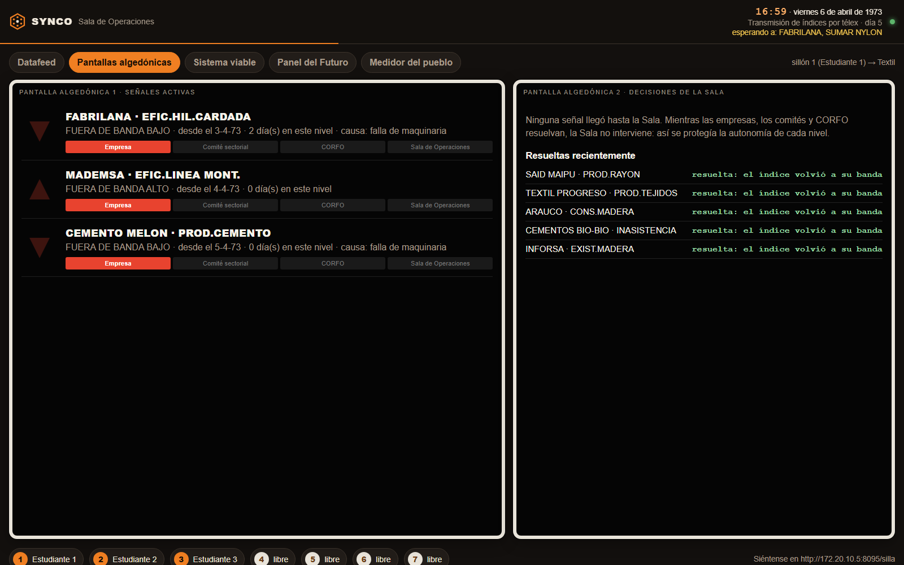
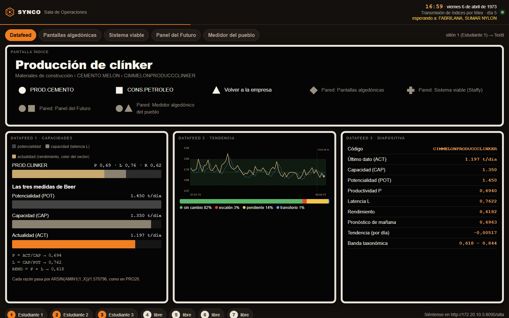
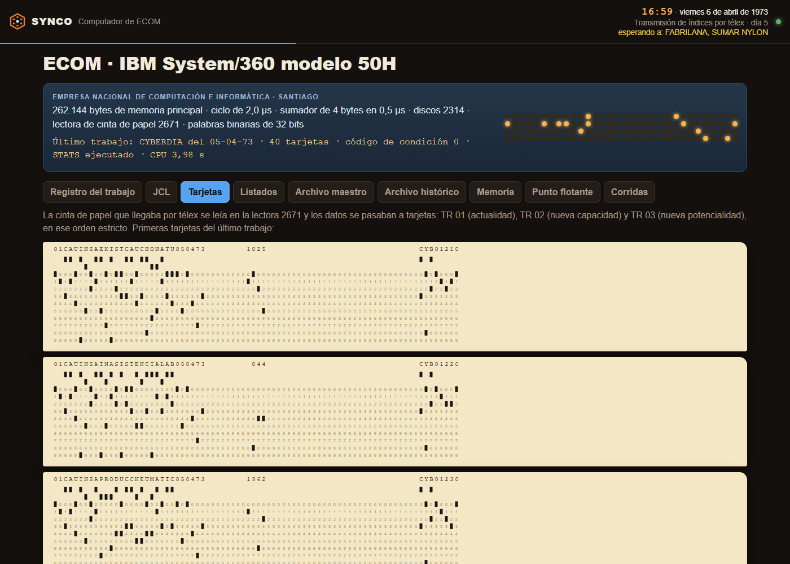
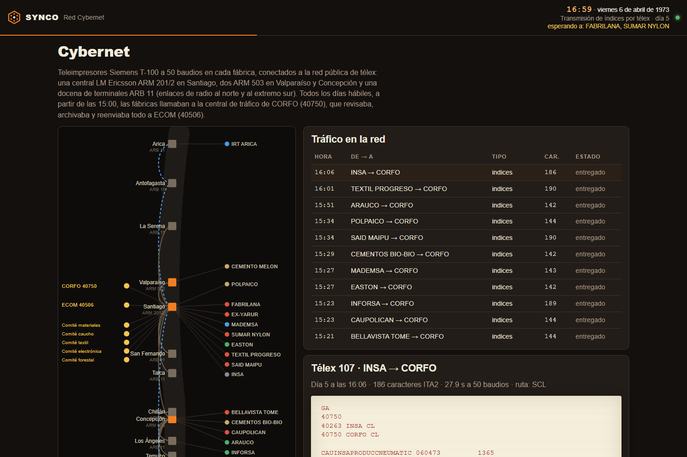

<div align="center">

# SYNCO

### El Proyecto Cybersyn (Chile, 1971–1973), funcionando otra vez

Un emulador para colegios y universidades. Un curso completo opera a la vez las fábricas, la red de télex, el computador IBM 360 y la Sala de Operaciones, en tiempo real y desde sus celulares.

**Desarrollado por Francisco Aldunate** · Talca, Chile · 2026

[](https://doi.org/10.5281/zenodo.23354093)

[**⬇ Descargar para Windows**](https://github.com/franciscoaldun/synco/releases/latest/download/synco.exe) · [Mac y Linux](https://github.com/franciscoaldun/synco/releases/latest) · [Guía para profesores](#guía-para-profesores) · [Qué fue Cybersyn](#qué-fue-cybersyn)

</div>



## En pocas palabras

- **Es un solo archivo de 8 MB.** No se instala ni necesita internet, cuentas ni base de datos.
- **Corre en el computador del profesor.** Los estudiantes entran desde el navegador del celular, por el mismo Wi-Fi de la sala, escaneando un código QR.
- **Reproduce la arquitectura real de Cybersyn**, pieza por pieza:
  - las fábricas y sus índices;
  - la red de télex, con su código de 5 bits;
  - el control de CORFO;
  - el IBM System/360 de ECOM, con sus tarjetas perforadas y su punto flotante;
  - el programa estadístico Cyberstride, con su filtro bayesiano;
  - las señales de alarma que suben de nivel;
  - el simulador económico CHECO;
  - la Sala de Operaciones y el medidor del pueblo.
- **Es gratis y de código abierto** (licencia MIT).

## Contenido

1. [Qué fue Cybersyn](#qué-fue-cybersyn)
2. [Cómo funcionaba: un día de Cybersyn](#cómo-funcionaba-un-día-de-cybersyn)
3. [Qué busca este proyecto](#qué-busca-este-proyecto)
4. [Qué trae SYNCO](#qué-trae-synco)
5. [Descargar y abrir](#descargar-y-abrir)
6. [Guía para profesores](#guía-para-profesores)
7. [Qué es documentado y qué es reconstrucción](#qué-es-documentado-y-qué-es-reconstrucción)
8. [Cómo se verificó](#cómo-se-verificó)
9. [Para desarrolladores](#para-desarrolladores)
10. [Fuentes](#fuentes)
11. [Autoría, cita y licencia](#autoría-cita-y-licencia)

---

## Qué fue Cybersyn

### El problema

En noviembre de 1970 asumió Salvador Allende. Su gobierno, la Unidad Popular, empezó a traspasar al Estado decenas y luego cientos de empresas: minas, textiles, cementeras, fábricas de neumáticos, de televisores, de papel. Ese conjunto se llamó el **Área de Propiedad Social** y quedó a cargo de la **CORFO** (Corporación de Fomento de la Producción).

El problema era práctico. Había pocos administradores con experiencia, la información llegaba con meses de atraso, la inflación subía y faltaban divisas y repuestos importados. ¿Cómo se conduce una economía así sin ahogarla en burocracia ni centralizarlo todo?

### La propuesta de Stafford Beer

En julio de 1971, **Fernando Flores**, el gerente técnico de CORFO, de 28 años, le escribió a **Stafford Beer**. Beer era un cibernético británico, autor de *Brain of the Firm* y del **Modelo de Sistema Viable**. Esa es una teoría de cómo se organiza cualquier sistema que sobrevive, desde una célula hasta un país: cada parte se maneja sola mientras pueda, y solo los problemas que no logra resolver suben al nivel siguiente.

Beer llegó a Santiago en noviembre de 1971. Según su propio relato, cuando le explicó el modelo a Allende y llegó al nivel más alto, el que fija el rumbo, Allende se echó para atrás en la silla y dijo: **«Por fin, el pueblo»**.

El proyecto se llamó **Cybersyn** (de *cybernetics* y *synergy*). En Chile se le conoció como **Proyecto Synco**, por *Sistema de Información y Control*. De ahí viene el nombre de este programa.

### Las cinco piezas

| Pieza | Qué era |
|---|---|
| **Cybernet** | La red de télex que unía las fábricas con CORFO y con el centro de cómputo. Usaba teleimpresores Siemens T-100 a 50 baudios (unos 6,7 caracteres por segundo), con el código ITA2 de 5 bits. |
| **Cyberstride** | Los programas estadísticos que corrían cada noche en el **IBM System/360 modelo 50** de ECOM (Empresa Nacional de Computación). Detectaban qué índice de qué fábrica se estaba saliendo de lo normal. |
| **CHECO** | *Chilean Economy*: un simulador de la economía chilena escrito en DYNAMO, el lenguaje de dinámica de sistemas de Jay Forrester. Servía para preguntar «¿qué pasa si…?». |
| **La Sala de Operaciones** | Una sala hexagonal diseñada por el equipo de **Gui Bonsiepe** en INTEC. Tenía siete sillones giratorios de fibra de vidrio con botones geométricos en el brazo y pantallas en las paredes. No había escritorios ni teclados. |
| **Cyberfolk** | Un medidor algedónico para la población. Cada persona movería una aguja entre «total intranquilidad» y «total satisfacción» mientras la televisión anunciaba una política. Beer lo diseñó en 1972, pero nunca llegó a instalarse. |

*Algedónico* viene del griego *algos* (dolor) y *hedoné* (placer). En la cibernética de Beer, una **señal algedónica** es un aviso de que algo duele o anda bien, y que sube de nivel si nadie lo atiende.

### Cronología

| Fecha | Hecho |
|---|---|
| Noviembre de 1970 | Asume Salvador Allende. Comienza a formarse el Área de Propiedad Social. |
| Julio de 1971 | Fernando Flores le escribe a Stafford Beer. |
| Noviembre de 1971 | Primera visita de Beer a Santiago y diseño del proyecto. Raúl Espejo queda como director de operaciones. |
| 21 de enero de 1972 | Primeros datos de cinco fábricas: Cemento Melón, Inforsa, Fabrilana, Textil Progreso y Said Maipú. |
| Marzo de 1972 | Alan Dunsmuir instala en ECOM la «suite temporal» de Cyberstride, con el método bayesiano de Harrison y Stevens. Beer escribe *Project Cyberfolk*. |
| Octubre de 1972 | Paro de unos 40.000 dueños de camiones. El gobierno coordina el abastecimiento con centros de mando unidos por télex: unos 2.000 mensajes diarios y unos 200 camiones leales. |
| Noviembre de 1972 | La «suite permanente» de Cyberstride, programada en Chile, entra en operación. |
| Comienzos de 1973 | Queda armado el prototipo de la Sala de Operaciones. La prensa británica y luego la chilena dan a conocer el proyecto. |
| 3 al 6 de abril de 1973 | ECOM manda a la Sala el télex con las señales algedónicas «a nivel CORFO» que conserva el archivo. Es la semana del escenario principal de SYNCO. |
| 11 de septiembre de 1973 | Golpe de Estado. El proyecto se abandona y la Sala se desmantela. |
| 2023–2024 | El Centro Cultural La Moneda reconstruye la Sala en la exposición *Cómo diseñar una revolución: la vía chilena al diseño*. |

### ¿Binario o ternario?

**Binario.** El IBM System/360 modelo 50 de ECOM tenía:
- 262.144 bytes de memoria, en palabras de 32 bits;
- texto guardado en EBCDIC;
- números reales en «punto flotante hexadecimal». Es base 16 para el exponente, pero igual se guarda en bits.

El télex usaba el código ITA2, de 5 bits por carácter. Los únicos computadores ternarios de la época fueron los soviéticos Setun y Setun-70, que no tuvieron relación con Cybersyn.

El punto flotante del 360 tiene una particularidad que SYNCO reproduce: **truncaba en vez de redondear**. Por eso, en el listado original de enero de 1972, un 25,4 tecleado en la fábrica aparece impreso como `25.39999`, y un 11656,9 como `11656.89844`.

### Lo que se exageró

En los relatos posteriores se repite que Cybernet conectaba cientos de empresas con 500 télex. Los documentos de archivo muestran algo más modesto:
- Cyberstride procesó datos de **cinco fábricas** en su primera corrida, en 1972;
- y de **unas veinte** en septiembre de 1973.

Más empresas estaban incorporadas «en algún grado», por ejemplo con sus procesos ya modelados: según Eden Medina, el 26,7 % de las nacionalizadas en mayo de 1973.

La Sala de Operaciones **no tenía conexión directa** con el computador. Sus gráficos se dibujaban a mano y se proyectaban como diapositivas. SYNCO muestra lo que el sistema estaba diseñado para hacer, y deja marcado qué parte es reconstrucción ([ver más abajo](#qué-es-documentado-y-qué-es-reconstrucción)).

---

## Cómo funcionaba: un día de Cybersyn



**1. La fábrica mide.** Cada proceso importante de una fábrica se había «modelado» antes con la técnica de flujogramas cuantificados de Humberto Gabella. De cada proceso salían tres números:
- **Actualidad (ACT):** lo que se produjo hoy.
- **Capacidad (CAP):** lo que se podría producir con los recursos que hay, si se resolvieran los problemas.
- **Potencialidad (POT):** lo que se podría producir con los recursos que razonablemente se podrían conseguir.

**2. La fábrica transmite.** Cada día hábil, desde las 15:00, la fábrica enviaba por télex sus índices a CORFO, un código de 22 letras con la fecha y el valor por línea. Un ejemplo real del archivo:

```
CIMMELONPRODUCCCLINKER 210172      1225.00000
```

`CIM` es el sector (materiales de construcción), `MELON` la empresa (Cemento Melón) y `PRODUCCCLINKER` el índice (producción de clínker).

**3. CORFO revisa.** La central de tráfico de CORFO revisaba el formato y pedía corrección si algo venía mal. Luego reenviaba todo por télex a ECOM.

**4. ECOM procesa.** En ECOM, la cinta perforada del télex se convertía en tarjetas perforadas, en un orden estricto:
- TR 01: actualidad;
- TR 02: nueva capacidad;
- TR 03: nueva potencialidad.

Esa noche corría el procedimiento `CYBER` en el IBM 360:
- **PRO10** validaba las tarjetas. Si encontraba un solo error, devolvía el código 8 y, por la instrucción `COND=(7,LT)` del JCL, **no se analizaba nada de nadie ese día**. Por eso la revisión de CORFO era tan importante.
- **PRO20** calculaba las medidas de Beer:
  - Productividad: P = ACT / CAP.
  - Latencia: L = CAP / POT.
  - Rendimiento: P × L = ACT / POT.

  Cada razón se normalizaba con `ARSIN(AMIN1(1.,X))/1.570796`. Después, el filtro bayesiano de **Harrison y Stevens (1971)** decidía si el último dato era normal o si había un cambio. Lo clasificaba en cuatro estados, con las probabilidades iniciales que usó Alan Dunsmuir en Chile:

  | Estado | Peso |
  |---|---|
  | Sin cambio | 75 % |
  | Escalón (caída o alza brusca) | 8,5 % |
  | Cambio de pendiente (deterioro o mejora gradual) | 14,5 % |
  | Dato transitorio (un solo día raro) | 2 % |

**5. Las señales suben.** Si un índice se salía de su banda normal, se emitía una **señal algedónica** dirigida primero a la propia empresa. Si la empresa no la corregía en el plazo, subía al comité sectorial, después a CORFO y por último a la Sala de Operaciones. Así se respetaba la autonomía de cada nivel: el gobierno central solo veía lo que nadie más había podido resolver.

**6. La Sala decide y CHECO anticipa.** En la Sala, siete personas revisaban las señales y elegían qué hacer. Por ejemplo, durante el paro de octubre, mandar camiones leales a una planta. CHECO permitía probar políticas antes de aplicarlas. Beer quería alimentarlo con los datos diarios de Cyberstride, algo que él mismo llamó «un sueño no cumplido». **En SYNCO ese sueño sí funciona:** el Panel del Futuro puede correr CHECO con el rendimiento real de la simulación.

---

## Qué busca este proyecto

Cybersyn se suele contar como una curiosidad o como una leyenda. Este proyecto busca que **se pueda vivir, no solo leer**:

- **Aprender haciendo.** Un estudiante que teclea su parte de producción y ve a CORFO rechazarle el télex por un dígito mal puesto entiende, sin que nadie se lo explique, por qué los datos limpios importan. Lo mismo vale para la autonomía de cada nivel o para lo difícil que es gobernar con información.
- **Recuperar un capítulo de la historia tecnológica de Chile**, con las fuentes de archivo que hoy existen y sin mitos.
- **Unir asignaturas.** Historia, educación ciudadana, matemática (razones, estadística, probabilidad bayesiana), tecnología, informática (arquitectura de computadores, codificación, punto flotante), economía (dinámica de sistemas) y diseño.
- **Funcionar en cualquier colegio.** No necesita internet, laboratorio de computación ni instalar nada. Basta un computador y los celulares de los estudiantes.
- **Abrir el debate actual** sobre datos, algoritmos, planificación, participación y vigilancia, desde un caso concreto de hace cincuenta años.

---

## Qué trae SYNCO

| Puesto | Quién lo usa | Qué emula |
|---|---|---|
| **Sala de Operaciones** (`/sala`) | El proyector | Las cinco paredes: el Datafeed (pantalla índice, capacidades, tendencias, diapositiva), las pantallas algedónicas, el Sistema Viable («Staffy»), el Panel del Futuro y el medidor del pueblo. |
| **Fábrica** (`/fabrica`) | Equipos de 2 o 3 estudiantes | 16 empresas reales del Área Social, con parte de producción, novedades del turno, formulario ECOM y teleimpresor Siemens T-100 con cinta perforada ITA2 y sonido. |
| **Sillón** (`/silla`) | 7 estudiantes | Los botones geométricos y el botón **HOLD** para tomar el control. Desde ahí se decide sobre las señales que llegan a la Sala. |
| **El pueblo** (`/pueblo`) | El resto del curso | El medidor algedónico de Cyberfolk. |
| **Red Cybernet** (`/red`) | Pantalla secundaria | El mapa de la red de télex, con las centrales de conmutación, los mensajes viajando y la cinta de cada télex. |
| **Computador de ECOM** (`/ecom`) | Universidades | El JCL, el registro del trabajo, las tarjetas perforadas, los listados de impresora, el archivo maestro en formato del 360, el mapa de memoria y un conversor de punto flotante. |
| **Panel del Futuro** (`/futuro`) | Universidades | Un intérprete DYNAMO completo con los modelos CHECO y Futuro. Las ecuaciones se pueden editar y correr. |
| **Panel del docente** (`/control`) | El profesor | El reloj, los escenarios, los imprevistos, las señales, los anuncios por televisión y los datos para exportar. |
| **Historia** (`/historia`) | Todos | El relato, la cronología, las personas y las fuentes. |

**En los celulares:** la fábrica, el sillón y el pueblo.



**La fábrica en un computador:** el parte de producción, las señales y el teleimpresor.



**Las pantallas algedónicas:** cada señal muestra en qué nivel va.



**La pantalla de un índice:** las tres medidas de Beer, la tendencia con su banda y lo que calcula el filtro bayesiano.



**El IBM 360 de ECOM por dentro:** las tarjetas perforadas generadas a partir de los télex.



**La red Cybernet:** los télex del día en el mapa.



---

## Descargar y abrir

| Sistema | Archivo |
|---|---|
| Windows 10 u 11 | [`synco.exe`](https://github.com/franciscoaldun/synco/releases/latest/download/synco.exe) |
| Mac con chip Apple (M1 o posterior) | [`synco-mac-arm64`](https://github.com/franciscoaldun/synco/releases/latest/download/synco-mac-arm64) |
| Mac con Intel | [`synco-mac-intel`](https://github.com/franciscoaldun/synco/releases/latest/download/synco-mac-intel) |
| Linux de 64 bits | [`synco-linux-x64`](https://github.com/franciscoaldun/synco/releases/latest/download/synco-linux-x64) |
| Linux ARM (Raspberry Pi de 64 bits) | [`synco-linux-arm64`](https://github.com/franciscoaldun/synco/releases/latest/download/synco-linux-arm64) |
| Todos juntos | [`SYNCO-1.0-todas-las-plataformas.zip`](https://github.com/franciscoaldun/synco/releases/latest/download/SYNCO-1.0-todas-las-plataformas.zip) |

### Windows

1. Abra `synco.exe` con doble clic.
2. Si aparece «Windows protegió su PC», haga clic en **Más información** y luego en **Ejecutar de todas formas**. El aviso sale porque el programa no tiene firma digital comercial.
3. Si Windows pregunta por el firewall, marque **Redes privadas** y haga clic en **Permitir**. Sin ese permiso, los celulares no pueden conectarse.
4. Se abren una **ventana negra** y el **navegador** con la portada. La ventana negra es el programa funcionando: **no la cierre durante la clase**. Ahí aparece la dirección que deben abrir los estudiantes.
5. Para terminar, cierre la ventana negra.

### Mac

Abra la aplicación Terminal y escriba (cambie el nombre si su Mac es Intel):

```sh
cd ~/Downloads
chmod +x synco-mac-arm64
xattr -d com.apple.quarantine synco-mac-arm64
./synco-mac-arm64
```

Si el Mac pregunta si acepta conexiones entrantes, elija **Permitir**.

### Linux

```sh
chmod +x synco-linux-x64
./synco-linux-x64
```

### Opciones

```
synco -puerto 8073 -escenario abril1973 -velocidad 1 -sin-navegador
```

| Opción | Qué hace |
|---|---|
| `-puerto` | Puerto de la red local (8073 por defecto, por 1973). Si está ocupado, prueba los 20 siguientes. |
| `-escenario` | `abril1973` (por defecto), `marzo1972` u `octubre1972`. |
| `-velocidad` | Multiplica la velocidad del reloj. |
| `-sin-navegador` | No abre el navegador al partir. |

Desde **otro** computador, el panel del docente pide la clave que muestra la ventana negra: `http://IP:8073/control?clave=XXXXXXXX`.

---

## Guía para profesores

### Lo que se necesita

- **Un computador** con Windows, Mac o Linux, idealmente conectado a un proyector.
- **Los celulares de los estudiantes**, con cualquier navegador actual (Chrome, Safari, Firefox). Sirven también notebooks o tablets.
- **Una red Wi-Fi** a la que estén conectados el computador y los celulares. **No necesita salida a internet.**

### Antes de la clase (15 minutos, una sola vez)

1. Descargue SYNCO y ábralo como se explica [más arriba](#descargar-y-abrir).
2. **Pruébelo con su propio celular:** conéctelo al mismo Wi-Fi, escanee el código «Fábricas» de la portada, tome una fábrica y transmita un télex.
3. Si el celular no carga la página, revise la sección [Si algo falla](#si-algo-falla). Es mejor descubrirlo antes que frente al curso.
4. Elija el escenario. Para la primera clase conviene **abril de 1973**.

### Los puestos

| Puesto | Cuántos | Qué hacen |
|---|---|---|
| **Profesor** | 1 | Proyecta la Sala de Operaciones y maneja el panel del docente en otra pestaña del mismo computador. |
| **Fábricas** | Grupos de 2 o 3 | Leen el parte de producción, copian la fecha y los valores en el formulario ECOM y tocan **«Llamar y transmitir la cinta»** antes de las 17:00 de la simulación. Si CORFO les pide corregir, corrigen y reenvían. Cuando a su fábrica le llega una señal, leen las **novedades del turno** y eligen una acción que ataque la causa. |
| **Sillones** | 7 | Se sientan en un sillón y, con los botones geométricos, cambian lo que muestra la pantalla grande: aprietan la figura (o la combinación de figuras) y esperan un segundo. Quien aprieta **HOLD** toma el control y los demás quedan bloqueados hasta que lo suelte. Cuando una señal llega hasta la Sala, deciden qué hacer. |
| **El pueblo** | El resto | Mueven la aguja de su medidor cuando el profesor anuncia una política. En la pantalla grande se ve el ánimo de todo el curso. |

Las fábricas que nadie toma funcionan solas, así que SYNCO sirve igual con un curso de 10 que de 40. Este último tamaño todavía no se ha probado en una sala real: si lo usa con un curso grande, [cuéntenos cómo le fue](https://github.com/franciscoaldun/synco/issues).

### Una clase de 45 minutos

| Minutos | Qué pasa |
|---|---|
| **0 a 5** | **Contexto.** Qué fue Cybersyn, en tres minutos. Puede usar la página *Qué fue Cybersyn* del propio programa. |
| **5 a 10** | **Conexión.** Proyecte la portada con los códigos QR. Arme los grupos de fábrica, elija a los siete de los sillones y el resto queda como pueblo. |
| **10 a 25** | **Dos o tres jornadas de trabajo.** Las fábricas transmiten, CORFO corrige, ECOM procesa de noche y aparecen las primeras señales. Comente en voz alta lo que pasa en la pantalla. |
| **25 a 35** | **La crisis.** En el panel del docente, use **«Provocar un imprevisto»** en una fábrica tomada por un grupo, por ejemplo una falla de maquinaria. Vea si el grupo la resuelve. Si no, la señal sube; con **«Llevar a la Sala»** puede adelantarla para que decidan los sillones. Luego anuncie una política por televisión («Se congelan los precios») y mire reaccionar al pueblo. |
| **35 a 45** | **Cierre y discusión.** Use las [preguntas de más abajo](#preguntas-para-discutir). |

> **Consejo:** cada jornada dura 75 segundos reales. Para un primer curso, suba **«Segundos reales por jornada»** a unos 150 en el panel del docente, así los grupos tienen más tiempo para teclear. Con **«Esperar a que los equipos transmitan»** activado, el reloj espera a los grupos atrasados hasta dos minutos.

### El panel del docente

| Control | Para qué sirve |
|---|---|
| **⏸ Pausar / ▶ Seguir** | Detiene el tiempo para explicar algo. |
| **⏭ Terminar esta fase** | Adelanta cuando el curso va lento. |
| **Velocidad** y **Segundos reales por jornada** | Ajustan el ritmo del día. |
| **Velocidad del télex** | 1 = 50 baudios reales. Más alto acorta la espera. |
| **Esperar a que los equipos transmitan** | El reloj no cierra la transmisión mientras falten grupos, hasta un máximo de dos minutos. |
| **CORFO revisa la consistencia de los télex** | Si lo apaga, un error de tipeo llega a ECOM y detiene el análisis de todo el país. Es una lección en sí misma. |
| **Si nadie decide en la Sala, decide el motor** | Útil cuando nadie ocupa los sillones. |
| **Imprevistos por fábrica y día** | Cuántos problemas aparecen solos en las fábricas. |
| **Autonomía** | Probabilidad de que cada nivel corrija solo un problema. |
| **Días en cada nivel antes de escalar** | Cuánto espera una señal antes de subir de nivel. |
| **Escenario** y **Reiniciar la sesión** | Empiezan de nuevo, con otra época. |
| **Anuncio por televisión** | Muestra una política en los medidores del pueblo. |
| **Fábricas** | Quién opera cada empresa. **QR** muestra un código para entrar directo a una fábrica y **Liberar** la suelta si un grupo se fue. |
| **Provocar un imprevisto** | Escalón (caída brusca), pendiente (deterioro gradual), dato transitorio o error de digitación, con su causa: materias primas, maquinaria, ausentismo, transporte, demanda o una mejora. |
| **Señales algedónicas activas** y **Llevar a la Sala** | Muestra las señales activas y permite llevar una de ellas a los sillones. |
| **Datos para analizar** | Descarga el histórico de Cyberstride (CSV, se abre en Excel), todos los télex (TXT) y la bitácora de la sesión. |

### Escenarios

| Escenario | Qué pasa | Bueno para |
|---|---|---|
| **Abril de 1973** | 16 empresas conectadas. Es la semana del télex real de ECOM a la Sala (3 al 6 de abril). | Una primera clase. |
| **Marzo de 1972** | Las cinco primeras fábricas: Cemento Melón, Inforsa, Fabrilana, Textil Progreso y Said Maipú. | Cursos chicos, o mostrar los comienzos. |
| **Octubre de 1972** | El paro de los camioneros. Casi todas las fábricas pierden el transporte y la Sala debe repartir unos 200 camiones leales, que alcanzan para pocas plantas. | Discutir prioridades y escasez. |

### Ideas de actividades por nivel

**Enseñanza básica (7° y 8°)**
- **Comunicarse sin internet.** Escribir su nombre en código ITA2 con la tabla de la página *Red* y calcular cuánto demora un mensaje a 6,7 caracteres por segundo.
- **¿Qué es una alarma?** Ver cómo una señal sube de nivel y discutir quién debería resolver cada problema.

**Enseñanza media**
- **Historia (Chile en los años sesenta y setenta).** Usar el escenario de octubre de 1972 para hablar del Área Social y del paro, con fuentes de distintas perspectivas.
- **Matemática.**
  - Productividad como razón.
  - Porcentajes y promedios con el CSV exportado.
  - La banda normal como «promedio ± desviación».
  - Qué significa que el filtro diga «82 % sin cambio».
- **Educación Ciudadana.** Cyberfolk: ¿es participación apretar un medidor? ¿En qué se parece a una encuesta o a los «me gusta» de hoy? ¿Dónde está el límite con la vigilancia?
- **Tecnología.** Sistemas, retroalimentación y autonomía: diseñar en papel el «sistema viable» del propio colegio.

**Universidad**
- **Ingeniería industrial e investigación de operaciones.** Indicadores ACT/CAP/POT, el Modelo de Sistema Viable y el filtro de Harrison y Stevens. Comparar las clasificaciones de SYNCO con las propias usando el histórico.
- **Informática y computación.**
  - La arquitectura del System/360, EBCDIC y las tarjetas Hollerith.
  - Por qué 25,4 se imprime `25.39999`: la pestaña *Punto flotante* de la página *ECOM*.
  - El código ITA2 con cambio de letras a cifras.
  - El JCL y los códigos de condición.
- **Economía.** Editar las ecuaciones de CHECO en el Panel del Futuro y probar políticas monetarias y salariales. En una corrida de prueba con el rendimiento de la simulación (0,55), los precios se multiplicaron por 20 en diez años.
- **Historia y sociología de la tecnología.** Fuentes primarias contra relatos posteriores: ¿por qué se infló el tamaño de la red?
- **Diseño.** La Sala de Bonsiepe: botones geométricos, la ausencia de teclados, a quién se pensaba como usuario.

### Preguntas para discutir

1. **¿Quién decide?** Cybersyn dejaba que cada nivel resolviera sus propios problemas antes de escalar. ¿Era eso más o menos democrático que decidirlo todo desde arriba?
2. **¿Qué pasa cuando los datos vienen mal?** Un solo error de tipeo podía detener el análisis de todo el país. ¿Qué se aprende de eso sobre los sistemas de hoy?
3. **¿Se puede gobernar con números?** ¿Qué cosas importantes de una fábrica no aparecen en un índice?
4. **Cyberfolk y las redes sociales.** Beer quería medir el ánimo de la gente en tiempo real. Hoy las plataformas lo hacen todo el tiempo. ¿Quién debería tener esa información?
5. **Mito y archivo.** ¿Por qué un proyecto pequeño terminó contándose como una red gigante? ¿Cómo se distingue una fuente primaria de un relato?

### Después de la clase

En **Datos para analizar** puede descargar el histórico de Cyberstride, con todos los índices de todos los días, todos los télex y la bitácora. Sirven para una tarea: graficar un índice, encontrar el día en que cayó y explicar por qué, o comparar las decisiones de distintos cursos.

### Si algo falla

| Problema | Solución |
|---|---|
| Los celulares no abren la página | Revise que estén en el **mismo Wi-Fi** que el computador y que haya permitido el acceso en el firewall (redes privadas). |
| Sigue sin funcionar en la red del colegio | Muchas redes institucionales impiden que los aparatos se vean entre sí («aislamiento de clientes»). Use la **zona Wi-Fi de su celular** o un router propio cualquiera, sin internet. Ojo: una zona Wi-Fi de celular aguanta pocos aparatos, unos 5 a 10. |
| Windows no deja abrir el programa | En «Windows protegió su PC», haga clic en **Más información** y luego en **Ejecutar de todas formas**. |
| La ventana negra se cerró | Ábrala de nuevo. La sesión vuelve a empezar: los estudiantes recargan la página y los grupos vuelven a tomar su fábrica. |
| Un grupo se fue y dejó su fábrica tomada | En el panel del docente, botón **Liberar**. |
| El reloj no avanza | Revise si está en pausa o si dice «Esperando a…». Use **Terminar esta fase**. |
| El panel del docente pide una clave | Solo pasa al abrirlo desde otro computador. Use el del proyector, o la clave de la ventana negra. |

### Un tema que todavía divide

Cybersyn es parte de un período que hasta hoy genera opiniones opuestas en Chile. SYNCO muestra **cómo funcionaba un sistema técnico** y en qué se basa cada afirmación. No toma partido sobre el gobierno de la época. Se recomienda presentarlo junto a fuentes de distintas perspectivas y dejar que el curso saque sus propias conclusiones.

---

## Qué es documentado y qué es reconstrucción

**Viene del archivo.** La fuente principal es la tesis de Diego Gómez-Venegas (Humboldt-Universität, 2024), basada en el archivo de Stafford Beer en Liverpool y el de Raúl Espejo. También el libro de Eden Medina.

- Los códigos de proceso de 22 letras y los valores del listado de la suite temporal (21 de enero de 1972).
- Las fórmulas de PRO20:
  - P = ACT/CAP;
  - rendimiento = ACT/POT;
  - L = rendimiento/P;
  - normalización `ARSIN(AMIN1(1.,X))/1.570796`;
  - índices inversos;
  - coeficientes estacionales.
- El filtro multiestado de Harrison y Stevens (1971) con los pesos de Dunsmuir: 75 / 8,5 / 14,5 / 2.
- El JCL del procedimiento `CYBER`: PRASMY01, PRO10, PRO20, `COND=(7,LT)`, discos 2314 y el volumen BIER01.
- Los números de télex de CORFO (40750) y ECOM (40506), el formato del télex de abril de 1973, el T-100 a 50 baudios y el código ITA2.
- El punto flotante hexadecimal del IBM 360, con truncamiento.
- Los nombres de las variables de CHECO y los nueve niveles del modelo Futuro.
- Las empresas: las cinco de la suite temporal y varias de las que se procesaban en 1973 (Cerro Blanco Polpaico, Cementos Bío-Bío, Sumar, Arauco y Easton) aparecen en el archivo. Las demás son empresas chilenas de la época sumadas para la simulación.

**Reconstruido o simulado.**
- Las cifras de producción de cada día, que son simuladas.
- Las ecuaciones completas de CHECO y Futuro, reconstruidas sobre sus variables y principios.
- Las varianzas del filtro.
- La distribución exacta de las columnas en las tarjetas y el archivo maestro.
- Los detalles que el archivo no conserva.

La página *Qué fue Cybersyn* del programa lo explica con el mismo cuidado.

---

## Cómo se verificó

- **Pruebas automáticas** (`go test ./...`):
  - el punto flotante reproduce exactamente los valores impresos en el listado de 1972;
  - la cinta ITA2 coincide bit a bit con la tabla de un télex real de ECOM;
  - el filtro bayesiano detecta escalones, cambios de pendiente y datos transitorios;
  - una jornada completa de 12 días corre sin errores;
  - un código mal tecleado sin la revisión de CORFO detiene el análisis con código 8, como en el original;
  - en el paro de octubre, los 200 camiones alcanzan exactamente para 8 envíos y vuelven a los cuatro días;
  - el intérprete DYNAMO y los códigos QR funcionan.
- **Una clase simulada contra el programa real:**
  - dos grupos transmiten y uno se equivoca en un código, que CORFO le pide corregir;
  - tres estudiantes se sientan en la Sala y el HOLD bloquea al resto;
  - el pueblo mueve sus medidores.
- **Pantallas:** todas las páginas se revisaron en computador y en celular, sin errores. Los códigos QR se leyeron con un lector independiente.
- **Resistencia:** 741 días simulados seguidos sin caerse, con 35 MB de memoria.

---

## Para desarrolladores

SYNCO está escrito en **Go 1.27**, solo con la biblioteca estándar. La interfaz es HTML, CSS y JavaScript sin dependencias, incrustada en el ejecutable. El tiempo real va por *Server-Sent Events*.

```sh
go test ./...
go build -trimpath -ldflags "-s -w" -o dist/synco.exe .
GOOS=linux  GOARCH=amd64 go build -trimpath -ldflags "-s -w" -o dist/synco-linux-x64 .
GOOS=linux  GOARCH=arm64 go build -trimpath -ldflags "-s -w" -o dist/synco-linux-arm64 .
GOOS=darwin GOARCH=arm64 go build -trimpath -ldflags "-s -w" -o dist/synco-mac-arm64 .
GOOS=darwin GOARCH=amd64 go build -trimpath -ldflags "-s -w" -o dist/synco-mac-intel .
```

Para trabajar en la interfaz sin recompilar: `go run . -web web`.

| Carpeta | Contenido |
|---|---|
| `main.go`, `servidor.go` | Servidor HTTP, API JSON, eventos en tiempo real, detección de la red local y clave del docente. |
| `motor/` | La simulación: catálogo de empresas, economía, télex e ITA2, CORFO, ECOM (JCL, tarjetas, PRO10, PRO20, archivo maestro), punto flotante del 360, filtro de Harrison y Stevens, señales algedónicas, Sala y pueblo. |
| `dynamo/` | Compilador e intérprete de DYNAMO (ecuaciones L, A, R, C, N, TABLE, SMOOTH, DELAY3…) con salida de impresora, y los modelos `checo.dyn`, `futuro.dyn` y `taller.dyn`. |
| `qr/` | Generador de códigos QR propio. |
| `web/` | Las páginas de cada puesto. |

---

## Fuentes

- Diego Gómez-Venegas, *Forecasting the Present: A Media-archaeo-genealogical Inquiry into Project Cybersyn*, tesis doctoral, Humboldt-Universität zu Berlin, 2024. [doi:10.18452/29151](https://doi.org/10.18452/29151)
- Eden Medina, *Cybernetic Revolutionaries: Technology and Politics in Allende's Chile*, MIT Press, 2011. En español: *Revolucionarios cibernéticos*, LOM, 2013.
- Eden Medina, «Designing Freedom, Regulating a Nation: Socialist Cybernetics in Allende's Chile», *Journal of Latin American Studies* 38 (2006): 571–606.
- P. J. Harrison y C. F. Stevens, «A Bayesian Approach to Short-term Forecasting», *Operational Research Quarterly* 22, n.º 4 (1971): 341–362.
- Stafford Beer, *Brain of the Firm*, 2.ª ed., Wiley, 1981; *Designing Freedom*, CBC Massey Lectures, 1973.
- Raúl Espejo, «Performance management, the nature of regulation and the CyberSyn project», *Kybernetes* 38 (2009).
- Gui Bonsiepe, *The Disobedience of Design*, Bloomsbury, 2021.
- G. Cantarelis, tesis sobre el modelo de Harrison y Stevens, University of Warwick, 1979. [wrap.warwick.ac.uk/34685](https://wrap.warwick.ac.uk/34685/)
- [Entrevista a Raúl Espejo, *Logic Magazine*](https://logicmag.io/play/raul-espejo-on-cybernetic-socialism-in-allendes-chile/)
- [Eden Medina, *Cabinet Magazine* n.º 46](https://www.cabinetmagazine.org/issues/46/medina.php)
- [Exposición *Cómo diseñar una revolución*, Centro Cultural La Moneda (ArchDaily)](https://www.archdaily.com/es/1006570/como-disenar-una-revolucion-la-via-chilena-al-diseno-se-inaugura-en-el-cclm-con-la-reconstruccion-del-proyecto-cybersyn)
- [Project Cybersyn en Wikipedia](https://en.wikipedia.org/wiki/Project_Cybersyn)

---

## In English

**SYNCO** is a portable, offline emulator of **Project Cybersyn**, the cybernetic management system built in Salvador Allende's Chile (1971–1973) under Stafford Beer. One executable runs on the teacher's computer and serves a local web app. A whole class can then operate, in real time from their phones:
- the factories and the Cybernet telex network, with ITA2 5-bit punched tape;
- CORFO's consistency check;
- ECOM's IBM System/360 running Cyberstride, with the original PRO20 formulas, Harrison–Stevens Bayesian filtering, punched cards, JCL and hexadecimal floating point;
- the algedonic escalation;
- the CHECO economic simulator, with a full DYNAMO interpreter;
- the Operations Room, with seven chairs and geometric buttons;
- Beer's never-built Cyberfolk meter.

The interface is in Spanish. Archival sources (Gómez-Venegas 2024; Medina 2011) are separated from reconstruction.

---

## Autoría, cita y licencia

SYNCO fue diseñado y desarrollado por **Francisco Aldunate Rodríguez**.

Es un proyecto independiente, sin relación con CORFO ni con las personas o instituciones del proyecto original, a quienes rinde homenaje.

**Para citarlo** (GitHub también ofrece el botón *Cite this repository*):

> Aldunate Rodríguez, F. (2026). *SYNCO: emulador del Proyecto Cybersyn (Chile, 1971–1973)* [Software]. Zenodo. https://doi.org/10.5281/zenodo.23354093

Ese DOI apunta siempre a la última versión archivada en Zenodo.

El código se publica bajo la [licencia MIT](LICENSE). Puede usarlo, copiarlo, modificarlo y compartirlo libremente, también en clases y talleres, siempre que mantenga el aviso de autoría.

<div align="center">
<br/>

**SYNCO** · Francisco Aldunate Rodríguez · Talca, Chile · 2026

[franciscoaldunate.cl](https://franciscoaldunate.cl) · [github.com/franciscoaldun](https://github.com/franciscoaldun) · franciscoaldun@gmail.com

</div>
